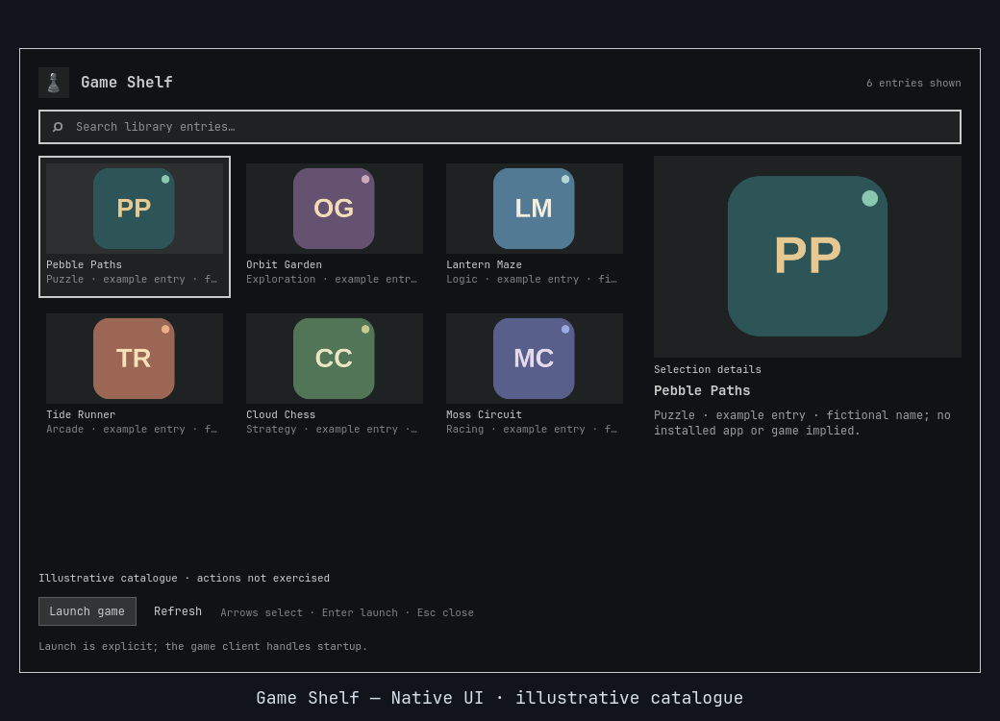

# Game Shelf

**One shelf for the games already on your machine.**

Bring local **Steam and Lutris** records into a searchable grid. Build an evening queue, return to a favorite, or open a game's folder, then let the matching client handle an explicit launch request.

[](https://github.com/Battlelamb/omarchy-game-shelf/actions/workflows/ci.yml)
[](LICENSE)

[Install](#install-and-open) · [Controls](#controls) · [Preferences](#make-it-yours) · [Limits](#limits-and-safety) · [Backend reference](BACKEND.md)

> **v0.3.0 · development/testing snapshot.** This is a source publication, not a stable release. Live open/close checks have passed; current client actions and full-shell upgrade/rollback remain unqualified. Launch acceptance is not proof of game startup or gameplay.



*Historical native Qt/Quickshell capture from an isolated headless compositor: six fictional example entries with original monogram artwork. No installed games are implied and actions were not exercised. This is not a v0.3.0 feature demonstration or a bundled library. [Preview provenance](docs/PREVIEW.md).*

## A library view, not another store

| Your next move | What Game Shelf provides |
| :--- | :--- |
| Find something installed | Search bounded local Steam manifests and native/Flatpak Lutris databases |
| Stay with one client | Provider filters with distinct native and Flatpak Lutris identities |
| Make an evening queue | Favorites and personal collections, such as an Evening group |
| Return to a recent choice | Recent IDs recorded after accepted launch requests |
| Inspect the files | **More → open folder**, using a freshly validated existing game directory |
| See a familiar cover | Existing local PNG/JPEG artwork where supported, without fetching it |

The default catalogue shows **installed records**. **Configure → Installed state → all / not-installed** includes only valid records already present in local metadata, not your online account library. Steam support tools can appear alongside games. Your results and artwork depend on your machine; no games or cover library are bundled.

## Install and open

Requires **Omarchy Quattro** with compatible Quickshell/Qt, `qs.Ui` and `qs.Commons`, system Python 3 and GNU `timeout`. Discovery does not require a running client; launching requires the matching Steam or Lutris installation. Flatpak requests require the corresponding installed Flatpak application. Opening folders uses `xdg-open`.

Review the source before enabling this testing snapshot:

```sh
omarchy plugin add https://github.com/Battlelamb/omarchy-game-shelf.git --enable
omarchy-shell shell summon leviathan.game-shelf
```

No shared hub, companion plugin or background indexing service is required.

<details>
<summary><strong>Optional: Super+Space → Trigger → Game Shelf</strong></summary>

Installation does **not** add a menu entry or hotkey. Back up `~/.config/omarchy/extensions/omarchy-menu.jsonc` and merge this entry into its existing top-level object, preserving other entries and adding the necessary comma between siblings. For a new file, use the whole object:

```jsonc
{
  "trigger.game-shelf": {
    "label": "Game Shelf",
    "action": "omarchy-shell shell summon leviathan.game-shelf"
  }
}
```

The `trigger.` prefix places it under the native **Trigger** category. Do not replace the stock menu or your existing extension file.

</details>

## Controls

| Input or control | Result |
| :--- | :--- |
| Type while the catalogue has focus | Search the current catalogue |
| Arrow keys / Home / End | Navigate the grid / first match / last match |
| Click a tile | Select only, without launching |
| Enter / primary Launch button | Request launch through the matching client |
| More | Toggle Favorite, open the game folder or manage collections |
| View selector | Open All items, Favorites, Recent or a personal collection |
| Configure | Save the default view, collection, provider and installed-state filter |
| Refresh | Rescan local metadata |
| Esc / outside click | Dismiss; Esc from Configure returns to the catalogue |

## Make it yours

Select a game, open **More**, enter a **Collection name** and choose **Add/remove item**. For example, make an Evening group for a short list of choices. Collections organize selections; they do not launch multiple games or change client libraries. **Delete collection** deletes only the group.

Open **Configure**, set your defaults and choose **Save settings**. Saved filters intersect, so a favorite from a different provider can be hidden. Recent updates after launch-helper acceptance, not after a game has been observed running; opening a folder does not add a recent launch.

Preferences survive source updates at:

```text
$XDG_CONFIG_HOME/omarchy/lego/game-shelf/preferences.json
```

If `XDG_CONFIG_HOME` is unset or relative, the fallback is `~/.config/omarchy/lego/game-shelf/preferences.json`. **Configure → Reset preferences** clears only this plugin's options, favorites, recent IDs and collections. Games, files and client databases are untouched.

## Limits and safety

- **A successful launch request is not a running-game guarantee.** The matching client handles startup. A timeout may follow partial acceptance, and dismissing the panel cannot undo a launch. There is no Restore.
- Actions revalidate local membership. Launch and folder access require a freshly recognized installed record; stored IDs and displayed paths cannot authorize arbitrary commands or directories.
- There is no store integration, online library sync, installer, download or direct execution of game binaries. Helpers use literal arguments without shell evaluation; the runtime is not itself a sandbox.
- Catalogue scans are bounded; displayed results are capped at **1,024 rows** and an additional byte budget. They are not an exhaustive inventory of every possible provider or installation layout.
- New preference saves have a **128 KiB aggregate budget**. Rejected saves preserve the file. A later Recent-save or optional-snapshot warning does not reverse a confirmed client request.

<details>
<summary><strong>Verification and troubleshooting</strong></summary>

Offline tests exercise real VDF/SQLite parsing, synthetic local databases and controlled client helpers in a fake HOME. They do not prove genuine client startup or gameplay. Native component tests use offscreen fixtures, not full-shell action integration. See [validation notes](docs/VALIDATION.md) and [CI scope](docs/CI.md); the badge links to the actual hosted workflow status.

From a checkout, with `TMPDIR` set to an existing private scratch directory:

```sh
env -u PYTHONPATH PATH=/usr/bin /usr/bin/python3 scripts/run-tests.py --backend-only
env -u PYTHONPATH PATH=/usr/bin bash test.sh
```

The backend runner needs `bwrap`; the full suite also needs Node.js and the native Qt/Quickshell test dependencies. Historical previews and earlier checks do not qualify v0.3.0 actions, full-shell upgrade/rollback or long-soak behavior.

| Symptom | Check |
| :--- | :--- |
| A known game is missing | Clear the query and filters, then Refresh; only supported local records are scanned |
| Lutris changes are missing | Immutable reads ignore uncheckpointed WAL; close/checkpoint the client, then Refresh |
| Native Lutris works but a Flatpak record fails | The clients are not interchangeable; install/configure the matching one |
| Folder action is rejected | A fresh installed record must supply a valid existing directory; missing or unsafe metadata is not guessed |
| Artwork is absent | Only bounded local PNG/JPEG lookups are supported; SVG and remote art are not fetched |

See [BACKEND.md](BACKEND.md) for exact provider roots, CLI commands, bounds and helper deadlines. Keep private library paths and provider logs out of public bug reports.

</details>

<details>
<summary><strong>Disable or remove</strong></summary>

```sh
omarchy plugin disable leviathan.game-shelf
omarchy plugin remove leviathan.game-shelf
```

Remove your optional menu entry separately. Use Reset first if you want this plugin's saved preferences cleared; do not delete client databases to reset the shelf.

</details>

---

Independent community plugin, not an official Omarchy, HyDE, Steam or Lutris product. Original code: **GPL-3.0-only**. No game/client binaries or third-party game art are bundled. [License](LICENSE) · [Source notices](NOTICE.md) · [Backend lineage](NOTICE.backend.md) · [Contributing](CONTRIBUTING.md) · [Security](SECURITY.md)
